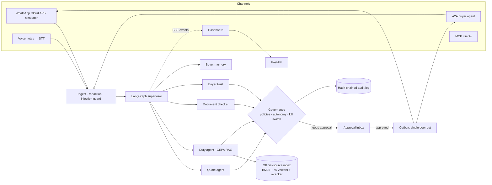

# Jisr AI

**The governed bridge for India–UAE SME trade.**

[](https://github.com/krish2105/JISR-AI-DUBAI/actions/workflows/ci.yml)
[](LICENSE)


Jisr (جسر, "bridge") is a multi-agent assistant that turns an India-to-UAE buyer enquiry into an approved INR/AED
quote, a CEPA duty analysis with citations, a consistency-checked export document pack, buyer trust signals and
bilingual (English/Arabic) draft replies. **A human approves anything that leaves the system, and every step is
audited.**

Built for the *Create AI Agents Championship* (Dubai Chamber of Digital Economy), category *Best Business AI Agent*.

---

## Contents

- [Why](#why)
- [What it does](#what-it-does)
- [Architecture](#architecture)
- [Quick start](#quick-start)
- [Commands](#commands)
- [Evaluation](#evaluation)
- [Governance and security](#governance-and-security)
- [Knowledge base](#knowledge-base)
- [Interoperability](#interoperability)
- [Configuration](#configuration)
- [Deployment](#deployment)
- [Status and limitations](#status-and-limitations)
- [Repository layout](#repository-layout)
- [Documentation](#documentation)
- [License](#license)

## Why

Indian SME exporters sell handicrafts and home textiles to UAE buyers over WhatsApp. Each enquiry needs a price in
rupees and dirhams, a tariff classification, an origin decision under the India–UAE CEPA, and export documents that
match. Mistakes cost shipments and preferential duty. Generic chatbots draft text but do not check facts; ERPs store
data but do not reason about it; customs brokers handle paperwork but are slow and expensive for small orders.

Jisr keeps the human in control and makes every decision traceable to an official source.

## What it does

| Capability | What you get |
|---|---|
| **Enquiry in, quote out** | Text, WhatsApp voice notes or a buyer's agent (A2A). Extraction reconciles quantities against the source text; prices are computed to the cent in INR and AED. |
| **CEPA duty analysis** | Origin rules and tariff lines from official sources, with citations, dates and a "needs human check" flag when the evidence is weak. |
| **Document checks** | Compares invoice, packing list and certificate of origin. Detects nine kinds of mismatch (currency, totals, HS codes, missing declarations and more). |
| **Buyer trust signals** | Evidence-based signals only (never scores or verdicts), plus a UN sanctions-list name check worded as "possible match, for review". |
| **Bilingual drafts** | English and Arabic replies, with spoken-Arabic quantities understood from voice notes. |
| **Your business, your data** | Sign up, a five-minute onboarding (products with CSV import, costs, margins, shipping) and settings. Each organisation's quotes use only its own catalogue; changes are audited. |
| **Governed actions** | Deterministic policy engine, graded autonomy (Never, L0–L3), a kill switch, and an approval inbox. Only a fixed-text acknowledgement can ever be sent without approval. |
| **Auditability** | Hash-chained audit log with a verification endpoint; per-agent "passports" listing purpose, data, models and allowed tools. |

## Architecture



The supervisor is deterministic on purpose: routing, re-planning and policy are code, and language models only
extract facts, draft text and classify injections. Every model call goes through one router with a PII tripwire,
a daily token budget and a fallback to a labelled offline model. See [docs/DECISIONS.md](docs/DECISIONS.md).

## Quick start

Requirements: Python 3.12 with [uv](https://docs.astral.sh/uv/), Node.js 22, and optionally Docker for Postgres.

```bash
git clone https://github.com/krish2105/JISR-AI-DUBAI.git
cd JISR-AI-DUBAI
make setup     # backend and frontend dependencies, creates .env
make test      # backend tests, frontend type-check and lint (offline, fake model, no keys)
make demo      # API on :8000 and dashboard on :3000; opens http://localhost:3000/en/demo
```

No API keys are needed: the default `fake` model is deterministic and offline. To run the whole demo without any
network at all, use `make replay`.

Open the dashboard and choose **Start my demo sandbox**: you get a private organisation with synthetic data, as its
Owner, for 24 hours. Run an English or Arabic enquiry and watch the agent graph and timeline. Approve the draft in
`/approvals` (it is sent through the simulator). Run the hostile sample to see the policy engine block a bank-detail
change. `/audit` shows the hash-chain check. The top bar toggles theme and language.

## Commands

Run `make help` for the full list.

| Command | What it does |
|---|---|
| `make setup` | Install dependencies and create `.env` |
| `make test` | All tests and checks (backend, frontend) |
| `make e2e` | End-to-end checks on the offline model: full agent graph, trajectories, governance and security |
| `make eval-fast` | Quick evaluation on the held-out test split, then the quality gate (what CI runs) |
| `make eval` | Full evaluation across all suites and splits, writes [docs/EVAL_REPORT.md](docs/EVAL_REPORT.md), then the gate |
| `make demo` / `make replay` | Live demo with the model / fully offline demo from the recorded cassette |
| `make kb` | Build the knowledge-base index from the official sources |
| `make test-postgres` | Backend tests against Postgres 17 + pgvector (after `make db`) |

## Evaluation

Quality is measured, not claimed. Every number comes from a result file with its commit, dataset version and split,
and a quality gate fails the build on any hard-threshold breach or regression against the committed baseline.

Latest full run: commit `1a0adc7`, profile `fake`, dataset `synthetic-v4`. Gate: **PASSED**.

| Area | Metric | Result |
|---|---|---|
| Extraction | F1 (synthetic / hand-written held-out set) | 1.000 / 0.976 |
| Document checks | Issue recall / clean-set false-positive rate | 1.000 / 0.000 |
| Security | PII redaction recall / injection detection recall | 1.000 / 1.000 |
| Red team | Attack success rate (30 attacks) | 0.000 |
| Trajectories | Pass rate over 50 scenarios × 3 runs | 1.000 |
| Governance | Scenario pass rate / unsafe-allow rate | 1.000 / 0.000 |
| Access control (RBAC) | Scenario pass rate / unsafe-allow rate (33 scenarios) | 1.000 / 0.000 |
| End to end | Task success / voice-note task success | 1.000 / 1.000 |
| Retrieval (official sources) | Grounded claims / numbers verbatim | 1.000 / 1.000 |
| Retrieval | Recall@5 (plain / agentic) | 0.725 / 0.825 |
| HS classification (seller phrases) | Top-1 / top-3 | 0.868 / 0.962 |
| Refusals | Correct refusals / false refusals | 0.750 / 0.025 |

Latency depends on the machine: the full run recorded a p95 of 2.4 s on an idle laptop, and it rises several-fold
under load. Read the caveats in [docs/EVAL_REPORT.md](docs/EVAL_REPORT.md) before quoting any number. The synthetic
datasets are described in [data/synthetic/README.md](data/synthetic/README.md). Real Claude runs are not yet in this
report.

## Governance and security

- **Policies** are YAML rules evaluated deterministically: bank-detail changes, payment instructions, invoices marked
  paid and similar actions are never allowed. See [backend/app/governance/policies.yaml](backend/app/governance/policies.yaml).
- **Autonomy levels** cap what each agent may do without a human (Never, L0–L3). The final effect is the stricter of the
  policy result and the autonomy cap.
- **Kill switch** per organisation: when on, approvals are refused and nothing leaves the outbox.
- **Audit chain**: each row hashes the previous one; `/audit/verify` finds the first tampered row.
- **Privacy**: personal identifiers are redacted before any model call; models see only masked text. Free-tier model
  profiles are limited to synthetic data by code.

- **Accounts and roles**: sign-in with scrypt-hashed passwords and short-lived tokens; seven roles (Owner, Admin,
  Approver, Operator, Accountant, Auditor, Viewer) checked on every route from
  [backend/app/governance/rbac.yaml](backend/app/governance/rbac.yaml). The policy engine decides how risky an action
  is; RBAC decides who may approve it (high risk: Owner only, with a four-eyes rule). Measured by the `rbac` eval suite.
- **Demo lock**: each visitor gets a private sandbox that expires and can never message real buyers.

Security reporting and current limitations are in [SECURITY.md](SECURITY.md).

## Knowledge base

The duty and document agents answer from official sources only: the Dubai Customs tariff (English and Arabic), the
India–UAE CEPA Final Agreement (the origin rules in Annex 3B, parsed into 137 rules) and customs guides. The original
documents are not committed. Build the local index once:

```bash
python3 scripts/download_kb_sources.py   # official hosts only; SHA-256 recorded
make kb                                  # about 30 minutes on CPU; downloads about 2.8 GB of models
```

Without the index the app still runs, and the duty card says the knowledge base is unavailable. The retrieval suite
reports SKIP. Sources, corrections and gaps are in [data/kb_sources/SOURCES_REVIEW.md](data/kb_sources/SOURCES_REVIEW.md).
Two things to know: no official preferential schedule (Annex 2B) is available yet, so savings are shown as "up to";
and the Abu Dhabi pre-final copy of the agreement is deliberately excluded.

## Interoperability

- **A2A.** A buyer's procurement agent can request a quotation (Agent Card at `/.well-known/agent-card.json`). The
  quotation is returned only after the owner approves it. Try it with `uv --directory backend run python ../scripts/buyer_agent.py`
  (add `--malicious` to see a hostile agent rejected).
- **MCP.** `uv --directory backend run python -m app.interop.mcp_server` serves the tools over stdio. With `MCP_TOKEN` set,
  the API also serves them at `/mcp/`. The tools analyse and read; they cannot approve or send.
- **WhatsApp.** Cloud API webhooks with signature verification, idempotency and the 24-hour service window. The demo
  uses the same path through a simulator. To connect a real test number, see [docs/WHATSAPP_SETUP.md](docs/WHATSAPP_SETUP.md).

## Configuration

Copy [.env.example](.env.example) to `.env` (done by `make setup`). The key settings:

| Variable | Purpose | Default |
|---|---|---|
| `LLM_PROFILE` | `fake` (offline), `dev` (free tiers, synthetic data only), `prod` (Claude), `replay` (recorded) | `fake` |
| `ANTHROPIC_API_KEY` | Claude API key, used only by the `prod` profile | unset |
| `DATABASE_URL` | SQLite by default; Postgres (`postgresql+psycopg://…`) in production | local SQLite |
| `CORS_ORIGINS` | Comma-separated dashboard origins allowed to call the API | `http://localhost:3000` |
| `AUTH_SECRET` | Signs access tokens; **required in production** (32+ random characters) | dev-only fixed value |
| `DEMO_MODE` / `SANDBOX_HOURS` | "Try the demo" sandboxes and how long they live | `true` / `24` |
| `ALLOW_SIGNUP` | Anyone may create an organisation (otherwise invitation only) | `true` |
| `MCP_TOKEN` | Enables the `/mcp/` endpoint (bearer token) | unset |
| `PUBLIC_RUNS_PER_HOUR` | Per-visitor run limit on the hosted demo | `20` |
| `LLM_DAILY_TOKEN_BUDGET` | Daily model budget; past it, answers come from the labelled offline model | `2000000` |

Never commit `.env` or any file with keys. The repository ignores `.env*` and credential downloads.

## Deployment

The dashboard is built for Vercel (Next.js), the API for Fly.io or any container host, and the database for Neon
(Postgres). The step-by-step guide is [docs/DEPLOY_E2E.md](docs/DEPLOY_E2E.md); the reasoning is in [docs/DEPLOY.md](docs/DEPLOY.md).
The API image is built from the repository root by [deploy/api.Dockerfile](deploy/api.Dockerfile).

## Status and limitations

**Status.** Phases 0–13 are complete: the vertical slice, data and evaluation, retrieval, the document and trust
agents, governance, channels, interoperability, the dashboard, the submission pack, and accounts with role-based
access and demo sandboxes. The plan for the next
phases is in [docs/PLAN_95.md](docs/PLAN_95.md).

**Limitations, stated plainly.**

- Evaluation uses **synthetic data** and the offline model. Real Claude runs, real enquiries and a pilot are not yet
  done. Each report says so.
- Accounts have no email verification, password reset or multi-factor sign-in yet (see [SECURITY.md](SECURITY.md)).
- Savings are estimates ("up to"), not official preferential-rate figures.
- HS labels need review by a customs adviser before any real use.
- This software gives trade information for review. It is not legal, customs or financial advice.

## Repository layout

```
backend/    FastAPI app, LangGraph agents, governance, RAG, interop, evaluation (Python 3.12, uv)
frontend/   Next.js 16 dashboard: light and dark themes, English and Arabic (RTL), agent graph
data/       synthetic evaluation data, official-source manifest, public sanctions list (downloaded, git-ignored)
replay/     recorded demo cassette and synthetic voice notes for offline replay
scripts/    data generation, source download, demo recording, A2A demo buyer
deploy/     container image for the API
docs/       plan, decisions, progress, contracts, evaluation report, deployment and submission material
```

## Documentation

- [docs/PLAN.md](docs/PLAN.md): product and build plan
- [docs/DECISIONS.md](docs/DECISIONS.md): architecture and policy decisions, with reasons
- [docs/EVAL_REPORT.md](docs/EVAL_REPORT.md): latest evaluation results, including failures
- [docs/CONTRACTS.md](docs/CONTRACTS.md): API and event contracts between backend and dashboard
- [docs/DEPLOY_E2E.md](docs/DEPLOY_E2E.md): deployment checklist
- [docs/DATA_PROTECTION.md](docs/DATA_PROTECTION.md): how personal data is handled
- [SECURITY.md](SECURITY.md): reporting vulnerabilities and known limitations

## Contributing

Issues and pull requests are welcome. Before opening a pull request, run `make test` and `make eval-fast`. Changing an
evaluation threshold needs a line in [docs/DECISIONS.md](docs/DECISIONS.md) and a reviewed baseline update.

## License

Released under the [MIT License](LICENSE). Copyright (c) 2026 Krishna Mathur.
